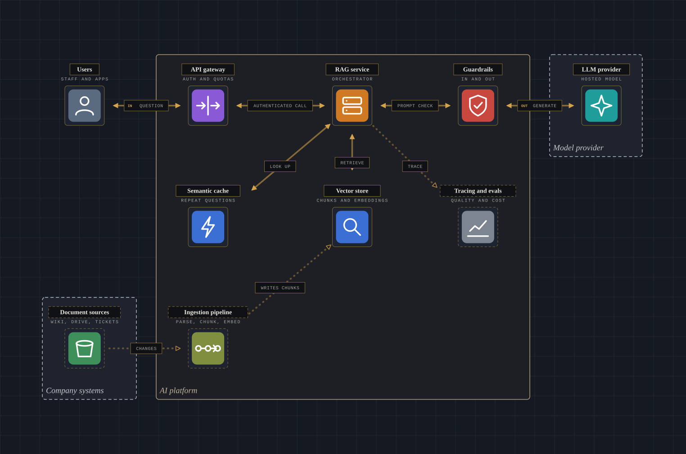

# arch-diagram-tool

Turn a small data spec (nodes, links, zones, per-node facts) into an interactive architecture diagram: a flat top view that toggles to a CSS-3D isometric view, with hover focus, clickable arrows that explain themselves, Flow / Security / Cost lenses, and a request-trace animation.

It is an architecture *explainer*, not a drawing editor. The diagram is a pure function of a validated spec.

> **Status: v0.1, ready to publish.** The spec schema, validator, renderer, router, lint, Terraform generator and a demo page with a generic icon pack are in place, with CI green. Live demo: <https://girishn.github.io/arch-diagram-tool/>. Licence: MIT. The portfolio at [girishn.cloud](https://girishn.cloud) still uses its own copy of the renderer; see [docs/PORTFOLIO-SWAP-IN.md](docs/PORTFOLIO-SWAP-IN.md) for the change to make there.

## Why

Drawing tools (draw.io, Lucidchart, Cloudcraft) need manual work, and diagrams-as-code tools (Mermaid, D2, Structurizr) give static output. This project defines the diagram as data, so it can offer:

- flat ↔ isometric views from one spec
- lenses (security, cost, ...) and a request trace as first-class spec features
- a completeness lint: every component described in the prose should appear as a node, and every node should explain itself
- later: generating the spec from Terraform (`terraform show -json`) or from a plain-English description

## Principles

- **Data-driven.** No diagram content lives in renderer code.
- **No heavy dependencies.** React, CSS 3D and SVG only. No three.js, d3 or UI kits.
- **Standard shapes.** Recognised icon sets, supplied by the user as icon packs. The spec holds opaque icon keys and never names a vendor. Generic shapes are the default.
- **Static-export friendly.** Works in a Next.js static export with no server runtime.
- **Accessible.** Buttons, aria labels, `prefers-reduced-motion`, keyboard focus, a 375px phone layout.

## Spec at a glance

```
DiagramSpec { version: 1, title, description?, nodes[], links[], zones?[], trace?[], prose?[], lenses?[] }
```

- **node**: `id, label, sub?, at {col,row}, icons[], detail? {tag, role, why, tradeoff}, lenses?`
- **link**: `from, to, label, detail?, via?, dashed?, labelAt?`
- **zone**: `id, label, bounds {c0,r0,c1,r1}, kind?`
- **trace step**: `node, label`
- **lens**: `id, label`

Full rationale and open questions: [docs/SCHEMA.md](docs/SCHEMA.md). Types: [src/schema.ts](src/schema.ts).

## Validating a spec

`validateSpec` has no dependencies. It returns a list of issues. A spec with no `error` issues is safe to render, and `warning` issues flag gaps in what the diagram explains.

```ts
import { validateSpec } from "./src/index.ts";

const issues = validateSpec(JSON.parse(json));
for (const i of issues) console.log(`${i.severity} ${i.path}: ${i.message}`);
```

Errors cover bad version or title, duplicate ids, two nodes in one cell, unknown link or trace nodes, self-links, malformed waypoints or zone bounds, undeclared lenses, and unreachable trace hops. Warnings cover nodes without detail, arrows without detail, grouped icons without captions, orphan nodes, nodes the trace never visits, and prose that mentions components with no node.

## Rendering a spec

```tsx
import { ArchExplorer } from "./src/index.ts";
import spec from "./examples/simple-web-app.json";

<ArchExplorer spec={spec} />
```

- `ArchExplorer` validates the spec (errors replace the diagram with a readable list, lint warnings sit in a collapsed note) and adds the request-trace controls. `ArchDiagram` is the diagram alone, for hosts that manage selection themselves.
- **Icons.** Pass `iconPack` (`{ resolve(key) => { tile, src | svg } }`) to use your own set. The default `genericPack` draws category-coloured tiles with simple glyphs inline, so there are no files to ship, and unknown keys fall back to a neutral icon. Build one from your own SVG files with `packFromSvgMap(svgs, { aliases, attribution, unmodified })` or from an Iconify JSON set with `packFromIconify(json, { attribution })` (both in `core`, plain data, no client-only code). `attribution` is shown in the legend, and under a static SVG, whenever one of the pack's icons is drawn. `unmodified: true` turns off everything the renderer does to an icon (rounded corners, dimming on peripheral cards, the light tile behind line icons) for sets whose terms say the icons must not be altered. You are responsible for the licence of any set you load.
- **Themes.** Colours and fonts are CSS custom properties (`--adg-bg`, `--adg-accent`, `--adg-font-serif`, ...), and five built-in themes bundle them: `brass` (default), `slate`, `paper` (light), `terminal` (monospace) and `contrast`. Pass `theme="paper"` (an id from `THEMES`) or your own `Theme` object. To show a picker in the toolbar, also pass `onThemeChange`; the host keeps the choice (the demo stores it in localStorage and themes its own page with `themeStyle`). Anything in the `style` prop overrides the theme. The CSS ships inside a `<style>` tag, so a static export needs no CSS loader.
- **Collapse containers.** Each container has a "−" button that shows it as one card, and the toolbar's Detail menu collapses whole tiers at once (level 1 is the outermost containers, the last level every innermost one, and All components opens everything). Arrows to the same place merge into "N connections", and the diagram gets smaller. It is a view only: the spec does not change, and `collapseZones(spec, ids)` is exported for your own use.
- **Zoom and pan.** Zoom with Ctrl or Cmd + wheel (a trackpad pinch arrives as the same thing), a two-finger pinch on touch, the + and - buttons, or the + and - keys with the diagram focused; wheel and pinch zoom towards the pointer or your fingers, over a range of 0.6x to 3x, and a plain wheel keeps scrolling the page. Once the diagram is larger than its frame you can pan it by dragging (both views), the arrow keys, or the Pan buttons. In the isometric view, shift-drag or right-drag rotates it (on touch, twist two fingers), and Rotate and Tilt buttons do the same, so nothing needs a drag. Panning stops where the far edge reaches the frame, so no part can be left out of reach, and Reset recentres it.
- **Trace.** Play steps through the request one component at a time; Show the path numbers every step on its card and lights the whole route with no animation (it starts on for visitors who prefer reduced motion).
- **Accessibility.** Cards and arrow labels are real buttons in a sensible tab order; focus does what hover does, and Escape dismisses it; each card is described by what it connects to; a "Diagram as text" panel gives the whole diagram in words; targets are at least 24 px on screen; selection is not shown by colour alone; forced-colours and reduced-motion are handled. The browser tests run axe in every theme. This is not a substitute for testing with a screen reader.
- **Static image.** `npm run export:svg -- --theme paper --out diagram.svg examples/rag-platform.json` draws the flat view as one self-contained SVG (literal colours, no scripts or animation, every arrow labelled), for a README, a slide or an og:image. It uses the same layout code as the live diagram. It shows the Flow view only; lenses and the trace are interactive. In code, `renderToSvg(spec, { theme, iconPack })` from `src/renderSvg.tsx` returns the string. It is not exported from the main entry because it needs `react-dom/server`.
- **Verifier tools.** `npm run verify -- validate|describe|diff|patch ...` and a small MCP server (`npm run mcp`, stdio) give an agent deterministic checks over a spec. `validate` returns every issue with a rule id and a JSON Pointer; `describe` is a compact summary; `diff` compares two specs by id (not array position); `patch` applies RFC 6902 operations (add, replace, remove, test) and refuses the whole patch if it would leave a new error, so an agent can repair its own output in a loop. Tools read spec files you name and never write, call the network or need a key. The same functions (`verify`, `describeSpec`, `diffSpecs`, `applyPatch`) are exported from `core`.
- **Arrows are routed around cards (the default).** Arrows are drawn in right angles that go around the cards, instead of straight lines. Each leaves and arrives by the side that faces the other card and ends touching the card (the pedestal in the isometric views), and arrows that share a side get their own spots along it, so twelve arrows into one card no longer meet at one point. Arrows that share a corridor run side by side. Pass `routing="straight"` to `ArchDiagram` or `ArchExplorer` (the demo has a checkbox, or `?routing=straight`) for the earlier straight lines, which honour the spec's waypoints (`via`); the router ignores them. `renderToSvg` takes the same option. `routeLinks` (from `arch-diagram-tool/core`) does the routing for your own code, and `measure(spec, portrait, true)` scores a layout as routed.
- **Wheel.** By default only Ctrl or Cmd + wheel (and a trackpad pinch) zooms, so a diagram never captures the page's scroll. Pass `wheelZoom="always"` to `ArchDiagram` or `ArchExplorer` and a plain wheel zooms towards the pointer; the page still scrolls when the pointer is elsewhere, at the fitted size when scrolling down, at the zoom limits, and while Alt is held. The demo uses `"always"` (add `?wheel=ctrl` for the default).
- **Thinning out arrows (both off by default).** `isolate` hides every arrow that does not belong to the selected component, container or arrow (instead of only dimming them); pointing at a component still shows its arrows meanwhile. `declutter` hides the minor arrows once the diagram is zoomed out below half size, keeping the arrows on the request path (or, with no trace, the ones not marked `offPath`) and any you select or point at; zooming in brings them back. Pass `isolate` and `declutter` to `ArchDiagram` or `ArchExplorer`; the demo has checkboxes, or use `?isolate=1` and `?declutter=1`.
- **Containers (zones) are selectable.** Press a container's label to light everything inside it, the arrows in and out, and the components they connect to; the rest dims. Press again or choose something else to clear it.
- **Layers and planes.** A spec may list `layers` from top to bottom (for a platform: golden path, control plane, runtime, tenants), give each node a `layer`, and tag nodes and arrows `plane: control | data`. Layers are drawn as **floors**: the flat view shows labelled bands, and the isometric view lifts each layer to its own height, with arrows running between floors. The `layers` prop (`"off" | "floors"`, default floors) and, in the demo, the Layers picker or `?layers=` turn them off. The **Planes lens** (`{ "id": "planes" }`) badges every tagged card and arrow Control plane or Data plane; planes are tags, not layers, so a layer and a plane are independent (see `examples/ai-platform-sim.json`). Floors are drawn with a 2D projection, not CSS 3D: the browser's 3D sorting painted tilted floors over upright cards. In floors the trace pulse is off. A band covers the rows its layer's cards use, so give each layer its own rows (a lint warning says when they overlap).
- **From Terraform.** Make JSON with `terraform show -json plan.out > plan.json` (a plan) or `terraform show -json > state.json` (what is deployed), then `npm run tf -- generate a.json b.json --overlay overlay.json --out spec.json`. Several files (a repo with a root module per concern) merge into one diagram. It reads the JSON only: no HCL, no state backend, no credentials. `npm run tf -- strip plan.json` first, if the file will be shared: it keeps addresses, references and the few attributes the mapping reads, and drops every other value, key and secret. A mapping table (`src/tfMapping.ts`, plain data) turns resource types into cards (one card per `for_each` instance where that is the point, such as Kafka topics), zones (VPC, subnet) and arrows. Arrows come from connector resources (Lambda permissions, event source mappings, API Gateway integrations, SNS subscriptions), from IAM (a role, its policies and the resources they name), from plain references (followed through module inputs and outputs), and from attribute values (a Kafka ACL names a service account and a topic, so it becomes a Reads or Writes arrow). Value-based arrows need known values, so use state or a plan made after the first apply; ones it cannot resolve are counted in the report, never guessed. Every type it does not draw is listed, never silently dropped. What Terraform cannot know (titles, explanations, lens facts, the trace, users, an outside model provider) lives in a hand-written **overlay**, keyed by node id or Terraform address; a key that matches nothing is an error, so a stale overlay fails CI. `npm run tf -- check ... --spec spec.json` regenerates in memory and exits 1, listing what moved, when the committed spec has drifted. `pin` writes every card's current cell into the overlay so a later plan change cannot rearrange the diagram. **Layout is a first draft:** columns follow the links and each connected group is laid out on its own, but a dense graph (a service that both reads and writes the same topics) tangles; the overlay's `hide` and `at` are how you curate it. Worked examples in `tests/fixtures/terraform/`: an AI chat assistant on AWS, and a Kafka order pipeline on EKS (22 cards after hiding dead-letter topics and tooling; 55 permission arrows from 59 ACLs). Covers AI-platform AWS types, EKS, ECR and Confluent Cloud so far; add a type by adding a row.
- **Pull-request check.** `npm run ci:check -- --base origin/main` (see `arch-diagram.config.json`) lints every diagram, lists what changed against the base branch by id, and re-generates each Terraform-made diagram in memory to fail when the committed one has drifted. It prints a Markdown report and exits 1 on any error. `.github/workflows/diagram-check.yml` runs it on pull requests, writes the job summary and keeps one comment on the PR up to date. The report is built from files a pull request controls, so config paths must stay inside the repo, the base ref is validated, and text is escaped and capped; the workflow uses `pull_request` (never `pull_request_target`) and passes the branch name through an environment variable.



- **Server rendering.** Nothing touches `window` during render; a unit test renders every example in plain Node to prove it.

## Development

```
npm install
npm run dev          # demo page with a live spec editor (http://localhost:5173)
                     # any examples/*.json appears in its picker; open one directly with ?example=<file name>
npm run typecheck
npm test             # Vitest: validator, layout, zones, themes, server rendering, property tests
npm run test:e2e     # Playwright in Chromium and WebKit: keyboard, reduced motion, forced colours, axe, 320 px (builds the demo first)
npm run test:all     # typecheck, unit tests and browser tests
npm run check-themes # WCAG contrast check for every built-in theme
npm run build:demo   # static build of the demo into dist-demo/
```

Requires Node and npm. React 19 is a peer dependency. Vite is a dev dependency used only for the demo.

## Package

`npm run build` writes `dist/` (Vite library build plus declarations); `npm run check:package` builds, smoke-tests the output in plain Node, then runs publint and are-the-types-wrong (CI does this). Three entry points, all ESM:

| Import | What | Notes |
| --- | --- | --- |
| `arch-diagram-tool` | `ArchExplorer`, `ArchDiagram`, icons, everything in `core` | Starts with `"use client"`, so a Next.js app can import it from a server file |
| `arch-diagram-tool/core` | Types, `validateSpec`, `lintSpec`, layout, themes, `measure`, lint output formats | No React and no directive: safe in a server component, a script or a CLI |
| `arch-diagram-tool/svg` | `renderToSvg` | Needs `react-dom/server` |

The CSS is injected by the component in a `<style>` tag, so `sideEffects: false` is safe and nothing needs a CSS import. The AWS icon pack is never part of the package (the smoke test fails if any such file would ship).

## Repo layout

| Path | What |
| --- | --- |
| `src/schema.ts` | Spec types |
| `src/validate.ts` | Dependency-free validator (errors and lint warnings) |
| `src/presets.ts`, `src/resolve.ts`, `src/zones.ts` | Lens presets, link defaults, zone geometry |
| `src/layout.ts` | Pure geometry: grid to pixels, cables, label placement, routing, zone rectangles (no React) |
| `src/icons.tsx` | Icon pack interface and the generic pack |
| `src/themes.ts` | Built-in themes (colours and fonts as `--adg-*` values) and `themeStyle` |
| `src/ArchDiagram.tsx`, `src/ArchExplorer.tsx`, `src/styles.ts` | The renderer, the trace explorer and the themeable CSS |
| `demo/`, `examples/` | Vite demo page and the example spec |
| `tests/unit/`, `tests/e2e/` | Vitest unit and property tests; Playwright browser tests |
| `scripts/contrast.ts`, `scripts/check-themes.mjs` | WCAG contrast maths and the theme check |
| `.github/workflows/ci.yml` | CI: typecheck, themes, unit tests, browser tests |
| `src/index.ts` | Public exports |
| `docs/CONTEXT.md` | Background, decisions made, known open issues, portfolio integration plan |
| `docs/SCHEMA.md` | Draft schema decisions awaiting confirmation |
| `assets/aws-icons-local-only/` | Official AWS icons for local development only. **Gitignored.** AWS lets customers use them in architecture diagrams, but redistribution is unanswered (backlog V1), so never publish them in a package. |

## Roadmap

1. Spec schema and validation (drafted)
2. Standalone renderer with a demo page and a generic icon pack (done for v0; package publishing and portfolio migration remain)
3. Generator CLI: Terraform to spec, then text to spec
4. Only then: a hosted editor

The portfolio will become the first consumer: it depends on the published renderer and keeps only its own spec file and icons.

## Known risks

- AWS icon redistribution is unanswered (backlog V1), so the package ships generic shapes or user-supplied packs. The demo can draw a local copy with `?icons=aws`; nothing else touches them.
- Safari support for CSS 3D and real-device touch (rotate, pinch) are untested.
